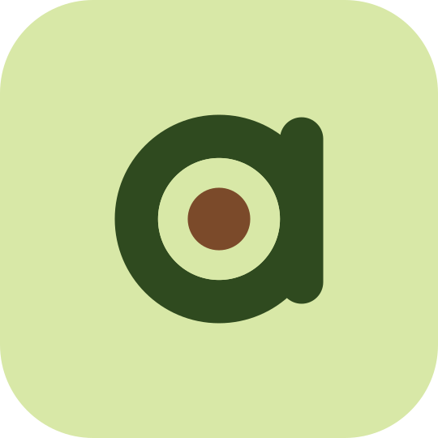
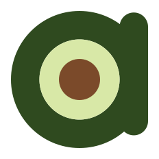

# Brand

Avo's logo is direction C of the logo exploration, **"Monogram a"**: a
lowercase *a* whose bowl is half an avocado — dark skin, light flesh, brown
pit — with a rounded stem on the right. It reads at favicon size and works as
a repository avatar.

  
  
  

## Colours

| Name | Hex | Use |
| --- | --- | --- |
| Skin | `#2F4A1F` | The letter; accent colour |
| Flesh | `#D8E8A7` | Icon background, inside the bowl |
| Pit | `#7B4A2A` | The pit |
| Deep | `#223519` | Wordmark and text on light backgrounds |
| Cream | `#FBF8F1` | Page background |

## Geometry

Measured from the approved artwork and rounded to clean ratios (outer bowl
radius = 1): hole 0.585, pit 0.300, stem width 0.415 (equal to the ring
thickness, flush with the bowl's right edge, tangent to the hole), stem caps
centred at y = −0.770 and +0.607. On a tile the bowl radius is 23.8 % of the
tile, centred.

## Files

| File | Use |
| --- | --- |
| `branding/svg/avo-mark.svg` | The mark alone (colour) |
| `branding/svg/avo-mark-mono.svg`, `avo-mark-white.svg` | One-colour versions |
| `branding/svg/avo-tile.svg` | Square tile with 21 % corners |
| `branding/svg/avo-avatar.svg` | Full-bleed square for GitHub and social avatars |
| `branding/svg/avo-favicon.svg`, `branding/png/favicon*` | Favicons (larger mark for 16 px) |
| `branding/svg/avo-icon-macos.svg`, `branding/png/Avo.icns` | Pre-macOS 26 app icon (continuous squircle, shadow) |
| `host/Avo/AppIcon.icon` | Icon Composer document (macOS 26 Liquid Glass, dark and tinted) |
| `host/Avo/Assets.xcassets/MenuBarIcon.imageset` | Menu bar template image |

Everything is generated from one geometry by
`python3 -I branding/tools/generate.py` (needs `rsvg-convert` and `iconutil`).

The wordmark "avo" from the exploration sheet is set in a typeface that could
not be identified from the raster; use the mark with plain text until the
wordmark is redrawn as outlines.
